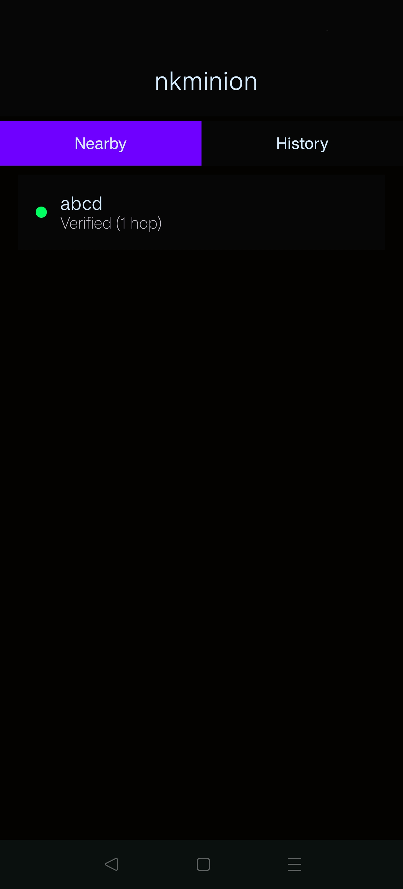
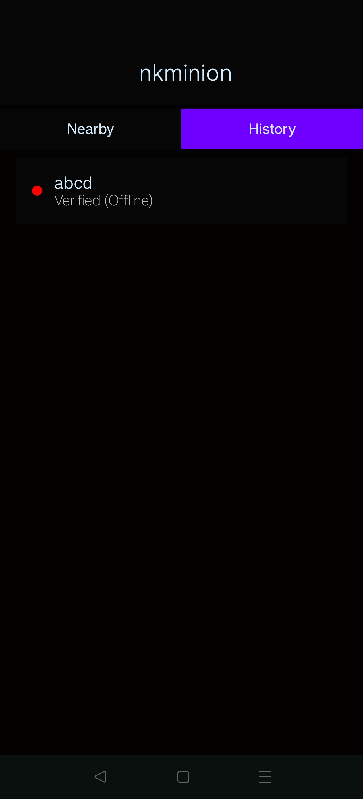
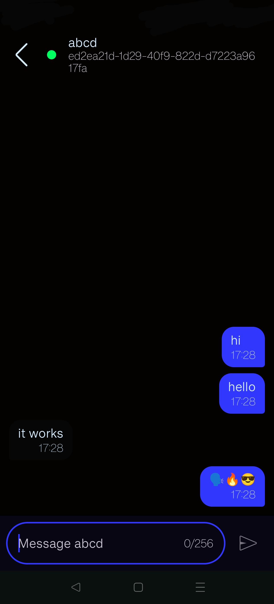

# Nodus

**Nodus** is an offline, peer-to-peer (P2P) encrypted mesh messaging application for Android. Built for communication without internet access, cellular towers, or centralized servers, Nodus connects nearby devices directly over Bluetooth and Wi-Fi Direct to exchange cryptographically verified messages.

---

## Features

* **Zero-Infrastructure Mesh Networking:** Discovers and connects to nearby peers automatically using the Google Nearby Connections API (Bluetooth + Wi-Fi Direct) with multi-hop relay support.
* **End-to-End Encryption (Double Ratchet):** Secures messages with ephemeral Elliptic Curve Diffie-Hellman (ECDH P-256) key exchange, HKDF-SHA256 key derivation, and AES-GCM authenticated encryption with forward secrecy and out-of-order skipped-key handling.
* **Out-of-Band SAS Verification:** Generates a 6-digit Short Authentication String (SAS) during pairing so users can visually confirm peer identity and prevent Man-in-the-Middle (MitM) attacks.
* **Local Persistence & History:** Stores verified node trust states and encrypted chat history locally using Room Database, allowing seamless reconnection with previously verified peers.
* **Modern Material 3 Interface:** Built with Jetpack Compose featuring adaptive dark and light themes, live nearby peer discovery, direct message notifications, and Android 13+ monochrome themed icon support.

---

## Screenshots

| Login Screen | Navigation Screen Nearby Tab | Navigation Screen History Tab | Text Screen |
| :---: | :---: | :---: | :---: |
|  |  |  |  |

## Tech Stack

* **Language:** Kotlin
* **UI:** Jetpack Compose (Material 3)
* **Networking:** Google Nearby Connections API
* **Cryptography:** Java Cryptography Architecture (ECDH P-256, ECDSA SHA256, HKDF-SHA256, AES-256-GCM)
* **Local Storage:** AndroidX Room (SQLite)
* **Background Execution:** Android Foreground Service (`connectedDevice`)

---

## Beta Installation (Android)

1. Navigate to the **[Releases](https://github.com/nkminion/Nodus/releases)** page and download the latest `nodus-v1.0.0-beta.apk`.
2. Open the downloaded `.apk` file on your Android device and allow **Install unknown apps** if prompted.
3. Launch **Nodus**, enter a display name, and grant the requested **Bluetooth**, **Nearby Devices / Location**, and **Notification** permissions.

### Quick Start (Pairing Two Devices)
1. Open Nodus on two nearby Android devices with Bluetooth and Wi-Fi enabled.
2. Wait for the other device to appear under the **Nearby** tab.
3. Tap the peer to initiate verification—a **6-digit SAS code** will appear on both screens.
4. Confirm the codes match on both devices and tap **Matches** to unlock encrypted messaging.

---

## Building from Source

### Prerequisites
* Android Studio (2025.3+ / Otter or newer)
* Android SDK **37.1** (`compileSdk = 37`, `compileSdkMinor = 1`)
* JDK 17+

### Steps
```bash
git clone https://github.com/nkminion/nodus.git
cd nodus
./gradlew assembleDebug
```

---

## Beta Disclaimer

Nodus is currently in **public beta (`v1.0.0-beta`)**. While it implements standard cryptographic primitives (ECDH, AES-GCM, Double Ratchet), the codebase has not yet undergone a formal third-party security audit. Do not rely on beta builds for high-risk or life-safety communications.

---

## License

This project is licensed under the MIT License — see the [LICENSE](LICENSE) file for details.